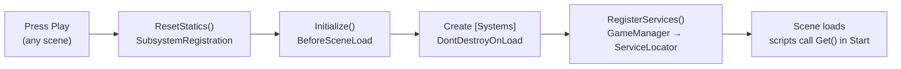

# Fractured Frequencies

Unity 6.3 LTS · single-player · Computer Game Praktikum

This README is the **Core Framework Specification**. Everyone on the team follows it when adding code.

## Contents

- [Getting started](#getting-started)
- [Overview](#overview)
- [Startup flow](#startup-flow)
- [ServiceLocator](#servicelocator)
- [EventBus](#eventbus)
- [GameManager and GameState](#gamemanager-and-gamestate)
- [Extending the framework](#extending-the-framework)
- [Coding conventions](#coding-conventions)
- [Git workflow](#git-workflow)

## Getting started

1. Clone the repo and open the folder with Unity Hub (Unity 6.3 LTS).
2. Open any scene and press Play.
3. Check that `[Systems]` appears in the Hierarchy under `DontDestroyOnLoad` and the Console shows no errors.

## Overview

The Core framework is the shared foundation every script builds on: global systems are created automatically, found through one registry, and talk to each other through events.

- **Single-player, offline.** There is no networking layer and none is planned.
- **Location:** `Assets/Scripts/Core/`
- **Namespace:** `FracturedFrequencies.Core`
- **Rule:** Core contains no gameplay code. Gameplay depends on Core, never the other way round.

| File | Responsibility |
| --- | --- |
| `GameBootstrapper.cs` | Entry point. Creates the persistent `[Systems]` object and registers all services before any scene loads. |
| `ServiceLocator.cs` | Global registry. Replaces singletons and `FindObjectOfType`. |
| `EventBus.cs` | Type-safe publish/subscribe events between systems. |
| `GameState.cs` | Enum of all high-level game states. |
| `CoreEvents.cs` | Events raised by Core systems (`GameStateChangedEvent`). |
| `GameManager.cs` | Owns the current game state; pause and resume. |

All six files depend on each other and must always be committed together.

## Startup flow

Nothing has to be placed in a scene: `GameBootstrapper` runs automatically when Play is pressed, in whichever scene is open, and every service is registered before the first `Awake` of any scene object.



Two methods carry `[RuntimeInitializeOnLoadMethod]`. `ResetStatics` clears the registry and all event listeners, which keeps play mode clean even when domain reload is disabled. `Initialize` creates the `[Systems]` GameObject, marks it `DontDestroyOnLoad`, and calls `RegisterServices`.

Rules:

- Do not create a `GameManager` or `[Systems]` object by hand in any scene.
- Do not delete or rename `[Systems]` at runtime.

## ServiceLocator

Every global system is accessed through `ServiceLocator`; singletons, `static Instance` fields and `FindObjectOfType` are not allowed. It is a static class: it is never placed in a scene or attached to a GameObject.

| Method | Use |
| --- | --- |
| `Register<T>(T service)` | Called only in `GameBootstrapper.RegisterServices`. Throws if `T` is already registered. |
| `Get<T>()` | Returns the service. Throws if it is not registered. |
| `TryGet<T>(out T service)` | Use when a service is optional. |
| `IsRegistered<T>()` | Checks without throwing. |
| `Unregister<T>()` / `Reset()` | Framework internal; do not call from gameplay code. |

```csharp
private GameManager _gameManager;

private void Start()
{
    _gameManager = ServiceLocator.Get<GameManager>();
}
```

Rules:

- Call `Get` in `Start` or later and cache the result in a private field. Do not call it every frame.
- Register only systems that live for the whole game. Scene-specific objects are referenced in the Inspector instead.
- Register a service once, under the type other code will ask for.

## EventBus

Systems that should not know about each other communicate through `EventBus<T>`: the sender raises an event, any number of listeners react, and neither side holds a reference to the other. Example: when the player dies, UI, audio and save logic each listen instead of the player script calling them.

| Method | Use |
| --- | --- |
| `EventBus<T>.Subscribe(handler)` | Start listening. Adding the same handler twice is ignored. |
| `EventBus<T>.Unsubscribe(handler)` | Stop listening. |
| `EventBus<T>.Raise(event)` | Send the event to all listeners. An exception in one listener is logged and does not stop the others. |

Defining an event:

```csharp
public struct PlayerDiedEvent : IGameEvent
{
    public Vector3 Position;
}
```

Listening and raising:

```csharp
private void OnEnable()  => EventBus<PlayerDiedEvent>.Subscribe(OnPlayerDied);
private void OnDisable() => EventBus<PlayerDiedEvent>.Unsubscribe(OnPlayerDied);

private void OnPlayerDied(PlayerDiedEvent e) { /* react */ }

// elsewhere
EventBus<PlayerDiedEvent>.Raise(new PlayerDiedEvent { Position = transform.position });
```

Rules:

- Events are `struct`s implementing `IGameEvent`, named `<Something>Event` in past tense (`PlayerDiedEvent`, `DoorOpenedEvent`).
- Events carry data only, no logic.
- Subscribe in `OnEnable`, unsubscribe in `OnDisable`. A missing unsubscribe calls a destroyed object and causes errors.
- Subscribe with a named method, not a lambda; a lambda cannot be unsubscribed.
- Use events for one-to-many notifications. When one system needs a direct answer from another, call it through `ServiceLocator` instead.
- Core events live in `CoreEvents.cs`; gameplay events live in the gameplay code that raises them.

## GameManager and GameState

`GameManager` is the single owner of the current `GameState`; no other script stores its own copy of "is the game paused" or "are we in the menu". It lives on the `[Systems]` object and is fetched with `ServiceLocator.Get<GameManager>()`.

| State | Meaning |
| --- | --- |
| `Boot` | Initial state before any scene has set a state. |
| `MainMenu` | Player is in the main menu. |
| `Loading` | A scene transition is in progress. |
| `Playing` | Normal gameplay. |
| `Paused` | Gameplay frozen, `Time.timeScale = 0`. |
| `GameOver` | Run ended; waiting for restart or menu. |

| Member | Behaviour |
| --- | --- |
| `State` | Current state, read-only. |
| `ChangeState(newState)` | Sets the state and raises `GameStateChangedEvent` (with `Previous` and `Current`). Does nothing if the state is unchanged. |
| `Pause()` | Only from `Playing`: sets `Time.timeScale = 0` and switches to `Paused`. |
| `Resume()` | Only from `Paused`: restores `Time.timeScale = 1` and the previous state. |

Rules:

- Change state only through `ChangeState`, `Pause` or `Resume`. Never set `Time.timeScale` directly for pausing.
- To react to a state change, subscribe to `GameStateChangedEvent`; do not poll `State` in `Update`.
- A new state is added to `GameState.cs` and to the table above in the same commit.
- Until scene loading is added, the first script in each scene calls `ChangeState` (for example `Playing` in a level).

## Extending the framework

A new global system is added in three steps and announced to the team before it is merged into `master`.

1. Create the class in `Assets/Scripts/Core/` (engine-level) or in the gameplay folders (game-specific), in the matching namespace.
2. Register it in `GameBootstrapper.RegisterServices`:

   ```csharp
   private static void RegisterServices(GameObject systemsRoot)
   {
       ServiceLocator.Register(systemsRoot.AddComponent<GameManager>());
       ServiceLocator.Register(systemsRoot.AddComponent<AudioManager>()); // MonoBehaviour service
       ServiceLocator.Register(new SaveSystem());                         // plain C# service
   }
   ```

3. Use it anywhere with `ServiceLocator.Get<AudioManager>()`.

Guidelines:

- A service needs `Update`, coroutines or Unity callbacks → MonoBehaviour added to `systemsRoot`. Otherwise → plain C# class.
- Services that depend on another service receive it in their constructor or an `Initialize` method, registered after the service they depend on.
- Adding an event: declare the struct next to the system that raises it; Core events go in `CoreEvents.cs`.
- Do not modify `ServiceLocator.cs` or `EventBus.cs` without agreement from the team.

## Coding conventions

Code, comments and commit messages are written in English.

| Element | Convention | Example |
| --- | --- | --- |
| Classes, structs, enums, methods, properties | PascalCase | `GameManager`, `ChangeState` |
| Private fields | `_camelCase` | `_gameManager` |
| Serialized fields | `[SerializeField] private` + camelCase | `[SerializeField] private float moveSpeed;` |
| Local variables, parameters | camelCase | `newState` |
| Constants | PascalCase | `MaxHealth` |
| Events | `<Subject><PastVerb>Event` | `PlayerDiedEvent` |
| Namespaces | `FracturedFrequencies.<Area>` | `FracturedFrequencies.Core` |

- Prefer `[SerializeField] private` over public fields.
- Log through `Debug.Log` with the `[FF]` prefix for framework messages.
- One class per file; the file name equals the class name.

## Git workflow

Sourcetree + GitHub.

1. Work only on your own branch `dev/<name>`. Never push directly to `master`.
2. Before starting work, merge `master` into your branch and resolve conflicts there.
3. Commit `.meta` files together with their assets.
4. Merge into `master` through a GitHub Pull Request with a descriptive English title.
5. `master` must always open and run without errors.
6. Avoid two people editing the same scene; use prefabs or a personal test scene (`Sandbox_<name>`).
